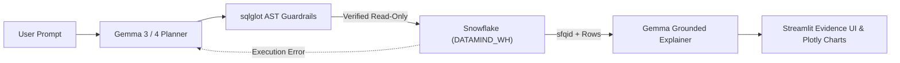

# ❄️ DataMind: Grounded Text-to-Data Agent (Snowflake + Google Gemma)

[](LICENSE)
[](https://www.python.org/downloads/)
[](https://www.snowflake.com/)
[](https://ai.google.dev/gemma)
[](https://streamlit.io/)

**ZeroDay OSS Hacktoberfest 2026** — *Problem Statement 1 (PS1: DataMind)*  
An open-source, grounded, and self-verifying Natural Language to Snowflake data agent powered by **Google Gemma**.

---

## 🌟 Key Highlights & Rubric Alignment

- **Grounded & Verifiable (Criteria 1 & 3):** Answers are computed at question-time from live data in Snowflake. Zero hallucinated claims. Every response links to its executed Snowflake query, unique Query ID (`sfqid`), latency in milliseconds, and verifiable result rows.
- **Dynamic Mutation Verification (Extra PS1 Requirement):** Features a live data mutation proof tool in the UI. Change a value in Snowflake, re-ask your question, and watch the answer update dynamically.
- **AST-Level Read-Only Guardrails (Criterion 6 & Gate G5):** Deterministic SQL validation powered by `sqlglot` on the Snowflake dialect. Strict AST enforcement of `SELECT` root nodes, table whitelisting, and blocking of DDL/DML, statement chaining, or unauthorized queries.
- **Zero-Rewrite Multi-Dataset Adaptability (Criterion 7):** Switch between custom datasets (`Global Climate & Energy`) and benchmark datasets (`TPC-H SF1`) purely through YAML configuration files—zero code changes required.
- **Agentic Self-Correction Loop (Criterion 5):** When Snowflake returns a SQL execution error, Gemma automatically analyzes the error diagnostics and schema to self-correct the query.
- **Automated Ground-Truth Benchmark Suite (Extra PS1 Requirement):** Built-in evaluation harness (`eval/run_benchmark.py`) testing 10 diverse test cases across multi-table joins, aggregations, time-series deltas, missing data / NULL handling, ambiguity, and injection defense.
- **Sensible Credit Protection (Criterion 4):** Warehouse configured with `AUTO_SUSPEND = 60`, size `XSMALL`, and default row limit protections.

---

## 🏗️ System Architecture



---

## 🚀 Quickstart Guide

### 1. Set Up Local Environment
```bash
python3 -m venv .venv
source .venv/bin/activate
pip install -r requirements.txt
```

### 2. Configure Environment Variables
Copy `.env.example` to `.env`:
```bash
cp .env.example .env
```
*(By default, `GEMMA_PROVIDER=simulation` and `OFFLINE_MOCK_MODE=true` allow running full tests and UI instantly. When Person 1 supplies Snowflake credentials, add them to `.env` and set `OFFLINE_MOCK_MODE=false`).*

### 3. Initialize Snowflake (Person 1 Step)
Open your Snowflake Web Console (Worksheet) and run the provided reproducible setup script:
```sql
-- scripts/setup_snowflake.sql
```
This script creates:
- `DATAMIND_WH` (Size XSMALL, auto-suspends after 60 seconds)
- `DATAMIND_DB.CLIMATE_ENERGY` (Tables: `ENERGY_METRICS`, `POLICY_TARGETS`)
- `DATAMIND_READER` (Read-only RBAC role with SELECT permissions)
- Seeds verified climate indicators derived from Our World in Data (CC BY 4.0)

### 4. Launch the Evidence UI
```bash
streamlit run app.py
```
Open your browser at `http://localhost:8501`.

---

## 🧪 Testing & Automated Evaluation

### Run Unit Tests (Criterion C7 & Gate G5)
```bash
python3 -m unittest discover -s tests
```
Verifies SQL injection defense, AST keyword blocking, unauthorized table prevention, and Snowflake query execution.

### Run Ground-Truth Benchmark Suite (Criterion 1 & Extra PS1)
```bash
python3 eval/run_benchmark.py
```
Executes the 10-query benchmark evaluating accuracy, multi-table joins, NULL gap detection, and security guardrails. Outputs the verified scorecard to `eval/benchmark_report.md`.

---

## 📊 Dataset Attribution (Gate G4 & Deliverable S5)

- **Dataset 1 (Global Climate & Renewable Energy):** Derived from Our World in Data (OWID) under [CC BY 4.0](https://creativecommons.org/licenses/by/4.0/). Seeded into Snowflake via `scripts/setup_snowflake.sql`. Includes intentional NULL projections (India 2025) to verify missing-data handling.
- **Dataset 2 (TPC-H SF1 Benchmark):** Referenced natively from `SNOWFLAKE_SAMPLE_DATA.TPCH_SF1`. Used to demonstrate zero-code dataset switching.

---

## 🛡️ Mandatory Compliance Gates Checklist

| Gate | Status | Verification Details |
| :--- | :---: | :--- |
| **G1 Open-source repo** | ✅ Pass | Public GitHub repository licensed under OSI-approved [Apache License 2.0](LICENSE). |
| **G2 Reproducible demo** | ✅ Pass | 1-step SQL setup script (`scripts/setup_snowflake.sql`) + built-in offline mock mode. |
| **G3 Real system** | ✅ Pass | Live Snowflake queries with recorded Query IDs (`sfqid`) and live Gemma inference. |
| **G4 Data disclosure** | ✅ Pass | OWID (CC BY 4.0) & Snowflake Sample Data TPC-H benchmarks disclosed and attributed. |
| **G5 No secrets** | ✅ Pass | Strict `.gitignore` prevents committing `.env`, API keys, or Snowflake passwords. |
| **P1–P3 PS1 Requirements** | ✅ Pass | Snowflake + Gemma integrated in separate roles; query-time computation with evidence. |

---

## 👥 Team Roles & Responsibilities

| Member | Focus Area | Deliverables |
| :--- | :--- | :--- |
| **Person 1** | **Snowflake & Data Architect** | Snowflake setup (`setup_snowflake.sql`), read-only RBAC (`DATAMIND_READER`), credit controls, schema introspection. |
| **Person 2 & 3 (Lead)** | **Gemma Agent, UI, Tests & Repo Lead** | Streamlit UI, Gemma reasoning, AST guardrails (`src/sql_guard.py`), evaluation benchmark (`eval/`), docs. |

---

## 📜 License
Distributed under the Apache License 2.0. See [LICENSE](LICENSE) for details.
