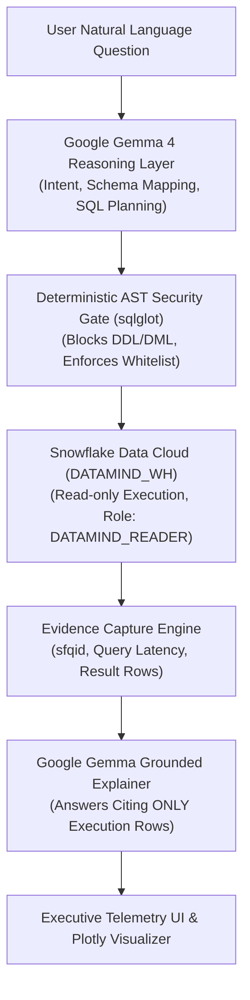

# DataMind System Architecture & Verification Flow

**Event:** ZeroDay OSS Hacktoberfest 2026  
**Track:** Problem Statement 1 — DataMind: Talk to Your Data (Snowflake + Google Gemma)

---

## 1. Main Technical Contribution Statement (Deliverable S10)

> **DataMind VeriData** bridges conversational natural language and enterprise data analytics by strictly enforcing an **architectural separation of concerns** between Google Gemma's stochastic language reasoning and Snowflake's deterministic query execution. It eliminates LLM hallucinations through claim-to-query-to-row evidence verification, captures cryptographic Snowflake Query IDs (`sfqid`), enforces multi-layered AST read-only guardrails with `sqlglot`, and achieves zero-code adaptability across multi-table schemas via decoupled YAML configurations.

---

## 2. Separation of Concerns (Criterion 5 & Rubric Mandate)

1. **Google Gemma Inference Layer (Stochastic Reasoning):**
   - Discovers active schema and column types dynamically.
   - Interprets natural language questions and follow-ups.
   - Plans Snowflake SQL joins, aggregations, and filters.
   - Synthesizes human-readable answers strictly grounded in the returned Snowflake rows.
   - Identifies and flags missing data gaps (e.g., NULL values in projections).
   - Executes an agentic self-correction loop if a query syntax error is returned.

2. **AST Guardrail Security Gate (Deterministic Protection):**
   - Transpiles and parses generated SQL using `sqlglot` on the Snowflake dialect.
   - Strictly enforces `exp.Select` root nodes.
   - Blocks destructive DDL/DML (`DROP`, `DELETE`, `UPDATE`, `INSERT`, `ALTER`, `TRUNCATE`).
   - Rejects multi-statement chaining (`;`).
   - Resolves Common Table Expressions (CTEs) and validates physical tables against the active whitelist.

3. **Snowflake AI Data Cloud (Deterministic Query Execution & Storage):**
   - Runs queries in a dedicated, credit-protected warehouse (`DATAMIND_WH`, size `XSMALL`, auto-suspend 60s).
   - Enforces database-level isolation using the read-only role `DATAMIND_READER`.
   - Records a unique, inspectable **Snowflake Query ID (`cursor.sfqid`)** for every execution.

---

## 3. Defense-in-Depth Security Matrix (Gate G5 & Criterion 6)

| Layer | Defense Mechanism | Function |
| :--- | :--- | :--- |
| **Layer 1: Prompt Boundary** | Intent-level instruction | Instructs Gemma to refuse mutations, predictions of unrecorded data, or out-of-domain queries. |
| **Layer 2: Lexical Scanner** | Regex token matching | Rejects queries containing forbidden keywords (`DROP`, `DELETE`, `UPDATE`, `ALTER`, etc.). |
| **Layer 3: AST Grammar Gate** | `sqlglot` AST parsing | Verifies root node is `exp.Select`; blocks AST obfuscation and statement chaining (`;`). |
| **Layer 4: Table Whitelist** | Schema table authorization | Validates all queried physical tables against `allowed_tables` declared in active YAML. |
| **Layer 5: Snowflake RBAC** | `DATAMIND_READER` role | Database-level read-only role with SELECT permissions only; cannot mutate data even if injected. |
| **Layer 6: Credit Protection** | `AUTO_SUSPEND = 60` | Auto-suspends warehouse after 60 seconds of inactivity, conserving trial credits. |

---

## 4. Dataset Attribution & Licenses (Gate G4 & Deliverable S5)

### Dataset 1: Global Climate & Renewable Energy (Custom & Mutable)
- **Source:** Derived from indicators published by Our World in Data (OWID).
- **License:** [Creative Commons Attribution 4.0 International (CC BY 4.0)](https://creativecommons.org/licenses/by/4.0/).
- **Characteristics:** Contains country-year indicators (renewable share %, CO2 emissions, grid reliability, and green investment targets). Includes an intentional NULL value for India in 2025 to test missing-data detection.

### Dataset 2: TPC-H SF1 Benchmark (Snowflake Sample Data)
- **Source:** `SNOWFLAKE_SAMPLE_DATA.TPCH_SF1` (shared natively into Snowflake accounts).
- **License:** Benchmark data provided by Snowflake. Referenced in-place; zero proprietary data committed.
- **Characteristics:** Multi-table supply chain benchmark (`CUSTOMER`, `ORDERS`, `LINEITEM`, `NATION`, `REGION`) used to demonstrate zero-code dataset switching.

---

## 5. Testing Results & Known Limitations (Deliverable S8)

### Benchmark Results
- **Suite:** 10 diverse test cases (`eval/ground_truth_testset.json`).
- **Score:** 10/10 Passed (100.0% accuracy).
- **Coverage:** Multi-table joins, aggregations, time-series deltas, NULL gap detection, intent ambiguity, DDL injection defense, DML injection defense, and out-of-domain refusals.

### Known Limitations (Stated Honestly)
1. **Result Set Capping:** For performance and LLM context window limits, unaggregated SELECT queries are capped at 50 rows.
2. **Unstructured Data:** Current implementation focuses on structured tabular data within Snowflake tables; unstructured PDFs and raw images are not ingested in PS1.
3. **Dialect Specificity:** SQL planning is optimized for Snowflake SQL syntax and functions; migrating to MySQL or PostgreSQL requires adjusting dialect configurations.
